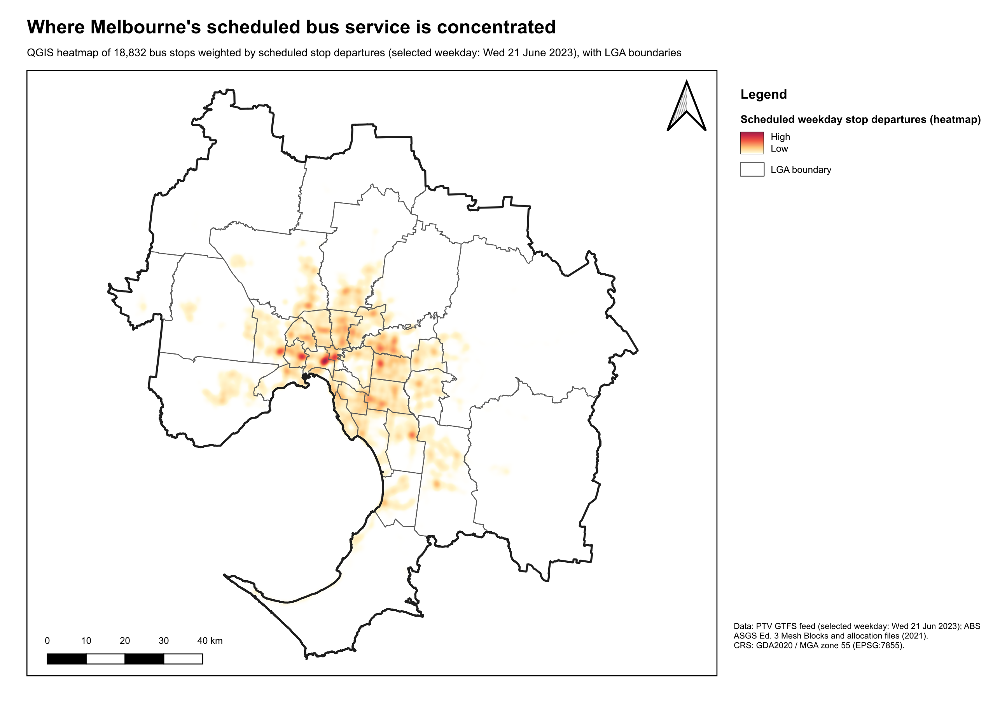
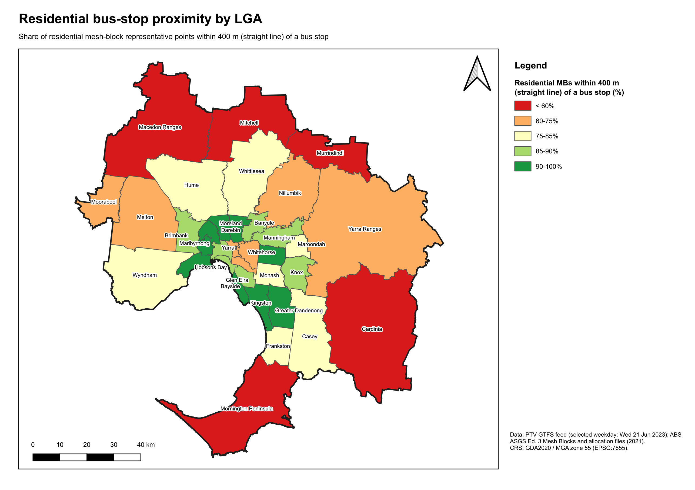
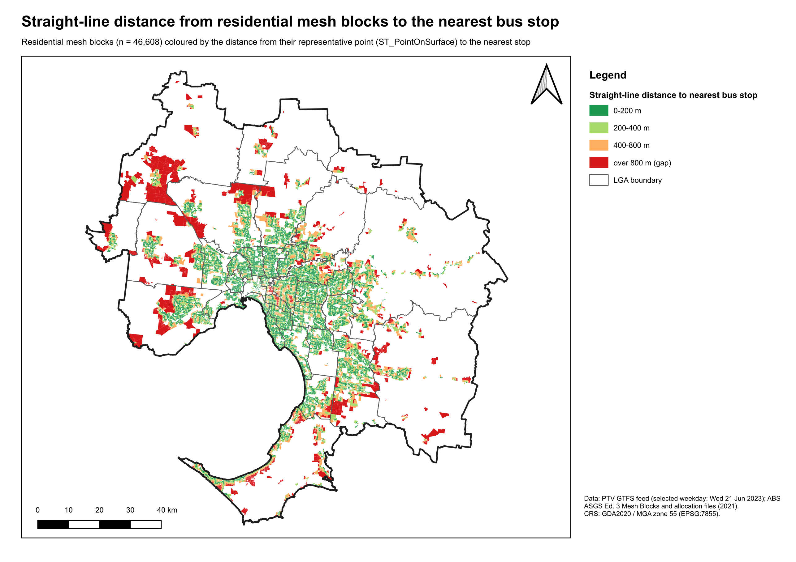
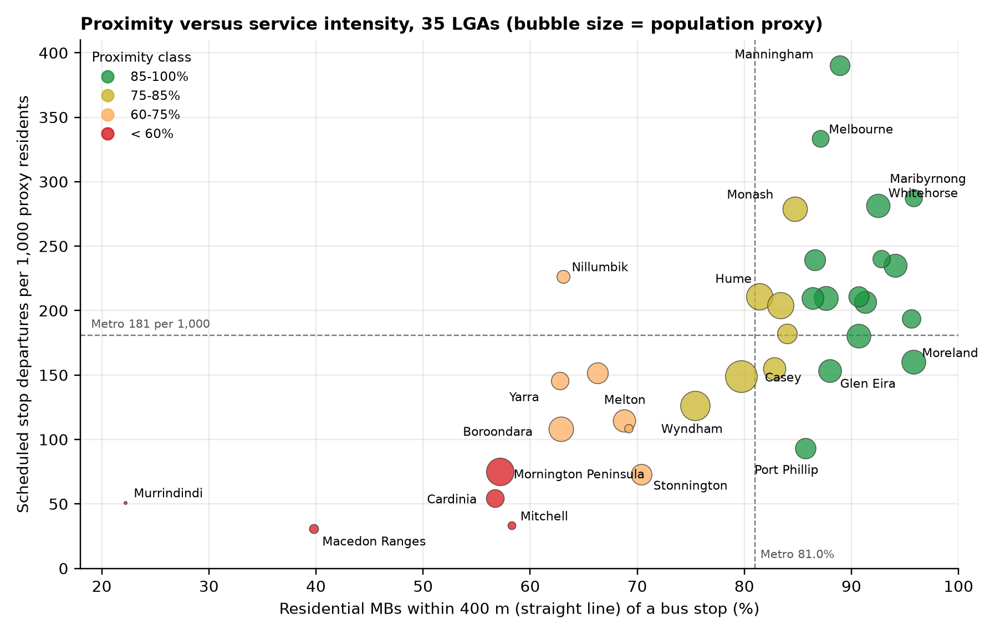

# Melbourne Bus Accessibility

A spatial SQL and QGIS project examining residential proximity to bus stops and scheduled bus-service intensity across Greater Melbourne. It combines a historical PTV GTFS snapshot with ABS 2021 Mesh Blocks and geographic allocation tables.

## Questions

1. How close are residential Mesh Block representative points to a bus stop?
2. How does scheduled stop-level service vary across LGAs and distance from the CBD?
3. Which areas warrant more detailed investigation?

## Selected findings

- 46,608 residential Mesh Blocks and 18,832 metropolitan bus-stop IDs.
- 81.0% of representative points within 400 metres of a stop; median straight-line distance approximately 202 metres.
- On the selected weekday, 21 June 2023, 18,664 stops have eligible service and there are 888,524 scheduled stop-departure events.
- 100 residential Mesh Blocks have a stop within 400 metres but no eligible scheduled stop departures within that catchment on the selected day.
- Proximity peaks in the 10-20 km CBD ring (88.8%, versus 82.2% within 10 km), then declines outward to 55.9% beyond 50 km.






## Method

Use GTFS route type 3, calendar validity and calendar-date exceptions to identify bus services. Preserve repeated source stop IDs, then use a documented representative-point rule in a derived stop layer. Represent each residential MB with `ST_PointOnSurface`. Transform to GDA2020 / MGA zone 55 (EPSG:7855), apply spatial indexes and a KNN nearest-stop query, and aggregate scheduled stop departures inside a 400 m straight-line catchment.

The 4,917,750 metropolitan population total is spread uniformly across residential MBs as an explicitly labelled population proxy. It is not observed MB- or LGA-level population.

## Interpretation boundaries

- Distances are representative-point, straight-line proximity measures, not household addresses, network walking distances or five-minute walking guarantees.
- Summed stop departures count the same trip at each nearby stop it serves; they are not distinct buses or headways.
- These are historical scheduled-service results, not current operations, ridership, reliability or observed demand.
- Bus-only comparisons do not establish access to rail or tram alternatives. Prioritisation indicates areas for further assessment, not an investment optimum.
- The weekend comparison SQL is an additional exploratory extension; its results are not asserted in the headline findings above.

## Data and repository layout

Raw feeds, database dumps and account credentials are not distributed. The repository contains project SQL, portable plotting code, map exports, and a 35-row aggregate LGA CSV. Matching historical inputs are needed to reproduce the saved snapshot exactly; current feeds will produce different results.

Expected external inputs are eight GTFS tables (`agency`, `calendar`, `calendar_dates`, `routes`, `trips`, `stops`, `stop_times`, `shapes`), the ABS 2021 GDA2020 Mesh Block polygon layer (`ptv.mb_2021`, geometry column `geom`), and MB-to-LGA / MB-to-SAL allocations. See `sql/00_source_tables.sql` for the expected tabular columns. Original GTFS text files use a CSV format; map columns explicitly when a newer feed schema differs. Load source inputs into a new database and retain source rows unchanged.

General source documentation:

- [GTFS schedule reference](https://developers.google.com/transit/gtfs/reference)
- [ABS Australian Statistical Geography Standard, Edition 3](https://www.abs.gov.au/statistics/standards/australian-statistical-geography-standard-asgs-edition-3/jul2021-jun2026)

## Reproduction

1. Prepare PostgreSQL/PostGIS, GDAL and a database containing the expected source inputs. Review creation/replacement operations before running SQL; use a disposable analysis database rather than production.
2. Run `sql/01_prepare_spatial_inputs.sql`, `02_bus_stop_routes.sql`, `03_residential_access.sql`, and `04_accessibility_analysis.sql` in order. The preparation script deliberately checks the original snapshot counts and refuses unexpected inputs.
3. Export `sql/05_export_lga_summary.sql` with psql to `data/lga_res_access.csv`.
4. Reproduce the scatterplot independently with the included aggregate CSV:

```sh
python -m pip install matplotlib
python scripts/plot_lga_comparison.py
```

5. Run `scripts/export_map_layers.sh` inside a PostGIS/GDAL environment. Copy its temporary GeoPackage to `data/processed/accessibility.gpkg` and execute `scripts/build_maps.py` in the QGIS Python environment, with `__file__` set by the script runner. Only the derived map exports are tracked; the GeoPackage stays local.

The saved plots and original SQL outputs were checked against the snapshot. The full database pipeline was not rerun while packaging this project.
